# Báo cáo tiến độ, phần TV2: Đối tác và nhập kho

| Mục | Nội dung |
|---|---|
| Thành viên | Lê Quốc Việt |
| MSSV | 2001240555 |
| Vai trò | TV2, module Quản lý đối tác và nhập kho |
| Bảng sở hữu | `ThuongHieu`, `NhaCungCap`, `PhieuNhap`, `ChiTietPhieuNhap` |
| Nhánh làm việc | tv2-tuan1 |
| Kiểm thử chéo | Module của TV3 (Sản phẩm và trưng bày) |

## 1. Phạm vi công việc

Chức năng phải chạy được, theo bảng phân công của nhóm:

- Xem danh sách, tìm kiếm theo từ khoá, thêm, sửa Nhà cung cấp và Thương hiệu, có xác thực dữ liệu đầu vào (`@Valid`).
- Chặn xoá Thương hiệu đang có Sản phẩm, chặn xoá Nhà cung cấp đã có Phiếu nhập, hiển thị cảnh báo trên giao diện.
- Lập Phiếu nhập bằng form động: thêm hoặc xoá dòng chi tiết sản phẩm, tính tiền tự động bằng JavaScript.
- Lưu đồng thời Phiếu nhập và Chi tiết phiếu nhập trong một transaction.
- Tự động cộng dồn số lượng nhập vào tồn kho (`soLuongTon`) của sản phẩm.
- Màn hình cảnh báo sản phẩm sắp hết hàng (tồn kho <= 10).

Module có hai quy trình nghiệp vụ cần chạy đúng: **ràng buộc khi xoá** và **nhập hàng cộng tồn kho trong một giao dịch**.

## 2. Use case

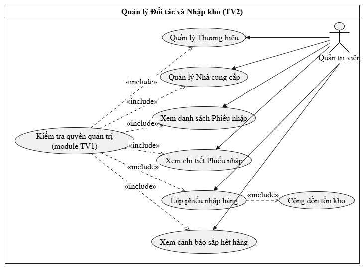

| Mã | Tên use case | Tác nhân |
|---|---|---|
| UC-TV2-01 | Quản lý nhà cung cấp (xem, tìm kiếm, thêm, sửa, xoá) | Quản trị viên |
| UC-TV2-02 | Lập phiếu nhập kho và cộng tồn kho | Quản trị viên |
| UC-TV2-03 | Quản lý thương hiệu (thêm, sửa, xoá có ràng buộc) | Quản trị viên |
| UC-TV2-04 | Xem cảnh báo sản phẩm sắp hết hàng | Quản trị viên |

Đặc tả chi tiết hai use case chính **UC-TV2-01 Quản lý nhà cung cấp** và **UC-TV2-02 Lập phiếu nhập kho và cộng tồn kho**
nằm trong tệp `dac-ta-use-case-tv2.md` cùng thư mục; bản tóm tắt ở phần Phụ lục cuối báo cáo.

## 3. Thiết kế dữ liệu các bảng của module

Quan hệ:

- `NhaCungCap` 1–n `PhieuNhap`: mỗi phiếu nhập thuộc đúng một nhà cung cấp.
- `PhieuNhap` 1–n `ChiTietPhieuNhap`: mỗi phiếu có nhiều dòng chi tiết.
- `ChiTietPhieuNhap` n–1 `SanPham` (TV3): mỗi dòng nhập đúng một sản phẩm.
- `ThuongHieu` 1–n `SanPham` (TV3): thương hiệu đang có sản phẩm thì không được xoá.

Nhà cung cấp đã có phiếu nhập không được xoá, nhằm giữ nguyên lịch sử nhập hàng.

**Bảng `thuong_hieu`**

| Cột | Kiểu | Ràng buộc | Ý nghĩa |
|---|---|---|---|
| `id` | bigint | Khoá chính, tự tăng | Mã thương hiệu |
| `ten_thuong_hieu` | varchar(100) | Duy nhất, bắt buộc | Tên thương hiệu |
| `xuat_xu` | varchar(255) | Bắt buộc | Nơi xuất xứ |

**Bảng `nha_cung_cap`**

| Cột | Kiểu | Ràng buộc | Ý nghĩa |
|---|---|---|---|
| `id` | bigint | Khoá chính, tự tăng | Mã nhà cung cấp |
| `ten_nha_cung_cap` | varchar(150) | Bắt buộc | Tên nhà cung cấp |
| `so_dien_thoai` | varchar(20) | Có thể trống | Số điện thoại |
| `email` | varchar(100) | Có thể trống | Địa chỉ email |
| `dia_chi` | varchar(255) | Có thể trống | Địa chỉ |

**Bảng `phieu_nhap`**

| Cột | Kiểu | Ràng buộc | Ý nghĩa |
|---|---|---|---|
| `id` | bigint | Khoá chính, tự tăng | Mã phiếu nhập |
| `ngay_nhap` | datetime | Mặc định: giờ hệ thống | Thời gian lập phiếu |
| `tong_tien` | bigint | Mặc định 0 | Tổng giá trị phiếu |
| `ghi_chu` | text | Có thể trống | Ghi chú thêm |
| `nha_cung_cap_id` | bigint | Khoá ngoại tới `nha_cung_cap(id)` | Thuộc nhà cung cấp nào |

**Bảng `chi_tiet_phieu_nhap`**

| Cột | Kiểu | Ràng buộc | Ý nghĩa |
|---|---|---|---|
| `id` | bigint | Khoá chính, tự tăng | Mã chi tiết |
| `so_luong` | int | Bắt buộc, lớn hơn 0 | Số lượng nhập |
| `gia_nhap` | bigint | Bắt buộc, lớn hơn 0 | Giá nhập 1 sản phẩm |
| `phieu_nhap_id` | bigint | Khoá ngoại tới `phieu_nhap(id)` | Thuộc phiếu nhập nào |
| `san_pham_id` | bigint | Khoá ngoại tới `san_pham(id)` | Nhập sản phẩm nào |

Từ điển dữ liệu đầy đủ của bốn bảng nằm trong tệp `tu-dien-du-lieu-tv2.docx`.

## 4. Mô tả chức năng và nơi cài đặt

Mỗi chức năng đi đúng khuôn Spring MVC CRUD của nhóm:
`Entity` → `JpaRepository` → `Service` + `ServiceImpl` → `Controller` → view Thymeleaf.

| Chức năng | Đường dẫn | Cài đặt chính |
|---|---|---|
| Xem danh sách, tìm kiếm nhà cung cấp theo từ khoá | `GET /admin/nha-cung-cap` | `AdminNhaCungCapController`, `NhaCungCapServiceImpl` |
| Thêm, sửa nhà cung cấp, xác thực `@Valid` | `GET /admin/nha-cung-cap/them`, `/sua/{id}`, `POST /luu` | `AdminNhaCungCapController`, `NhaCungCapServiceImpl` |
| Xoá nhà cung cấp, chặn khi đã có phiếu nhập | `POST /admin/nha-cung-cap/xoa/{id}` | `NhaCungCapServiceImpl.xoa`, `LoiNghiepVu` |
| Thêm, sửa thương hiệu, chặn xoá khi đang có sản phẩm | `/admin/thuong-hieu/...` | Controller và service thương hiệu, `LoiNghiepVu` |
| Lập phiếu nhập, form động thêm hoặc xoá dòng, tự tính tiền | `GET /admin/phieu-nhap/them` | `templates/admin/phieu-nhap/form.html` (JavaScript) |
| Lưu phiếu nhập, chi tiết và cộng tồn kho trong một transaction | `POST /admin/phieu-nhap/luu` | `AdminPhieuNhapController.luuPhieuNhap`, `PhieuNhapServiceImpl.luuQuyTrinhNhapHang` |
| Cảnh báo sản phẩm sắp hết hàng (tồn <= 10) | `/admin/canh-bao-kho` | Controller và service cảnh báo kho |

Cột Đường dẫn ghi theo quy ước đặt tên của nhóm, cần đối chiếu lại với route thực tế trong mã nguồn.

Một số điểm kỹ thuật đáng chú ý:

- **Giao dịch nhập hàng.** `PhieuNhapServiceImpl.luuQuyTrinhNhapHang` lưu `PhieuNhap`, các `ChiTietPhieuNhap`
  rồi cộng `soLuong` vào `soLuongTon` của từng `SanPham` trong cùng một transaction. Lỗi ở bất kỳ bước nào,
  kể cả cập nhật tồn kho, đều rollback toàn bộ, không lưu phiếu nhập, giữ nhất quán theo ACID.
- **Form lập phiếu động.** Quản trị viên bấm "Thêm sản phẩm" để thêm dòng, xoá dòng không cần; JavaScript tính
  thành tiền từng dòng (số lượng nhân giá nhập) và tổng tiền ngay khi nhập, đồng thời chặn gửi form khi chưa chọn
  nhà cung cấp hoặc số lượng, giá nhỏ hơn hoặc bằng 0. Phía máy chủ vẫn xác thực lại dữ liệu.
- **Không xoá mất lịch sử.** Nhà cung cấp đã có phiếu nhập thì `NhaCungCapServiceImpl.xoa` ném `LoiNghiepVu`,
  giao diện hiện cảnh báo đỏ và dữ liệu giữ nguyên. Thương hiệu đang có sản phẩm cũng bị chặn xoá tương tự.
- **Xác thực dữ liệu đầu vào.** Biểu mẫu nhà cung cấp và thương hiệu dùng `@Valid`; lỗi hiện dưới từng ô.
- **Cảnh báo kho thấp.** Màn hình riêng liệt kê sản phẩm có `soLuongTon` <= 10 để thủ kho kịp lập phiếu nhập mới.

## 5. Màn hình thực thi

### 5.1. Nhà cung cấp và thương hiệu

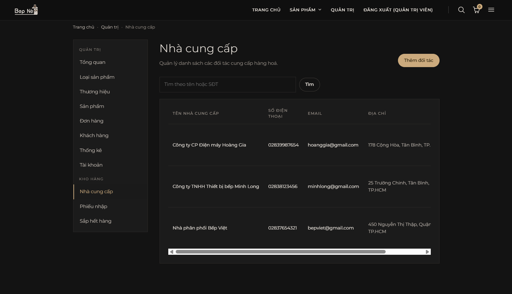

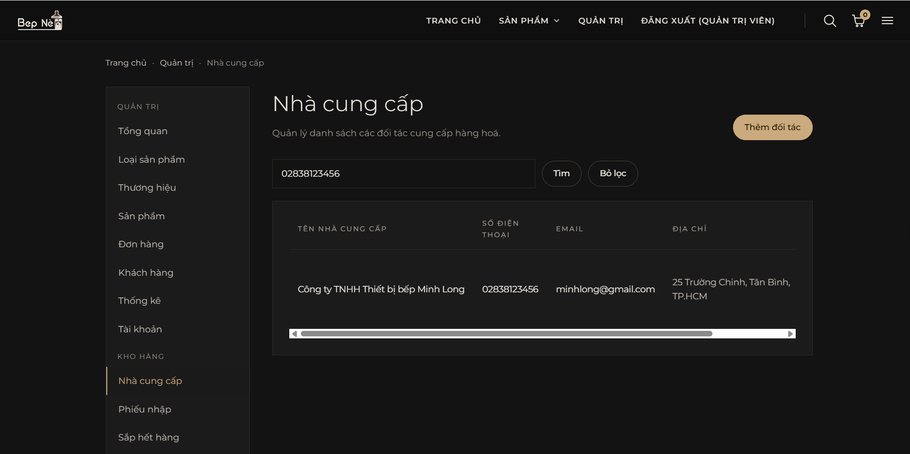

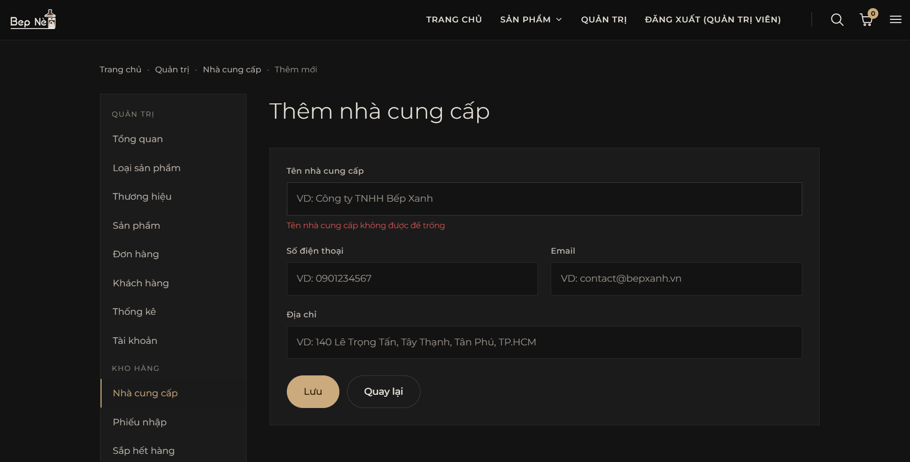

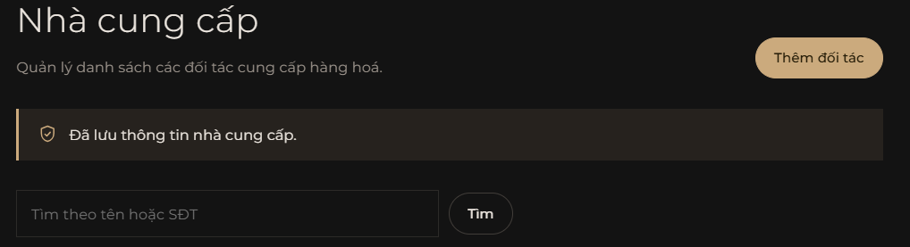

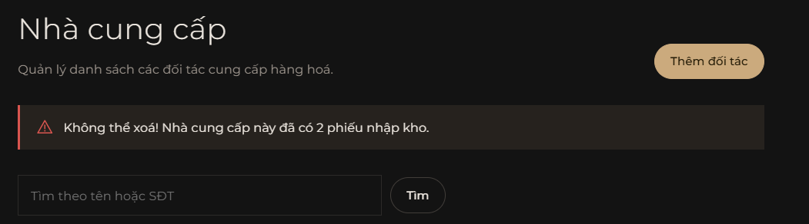

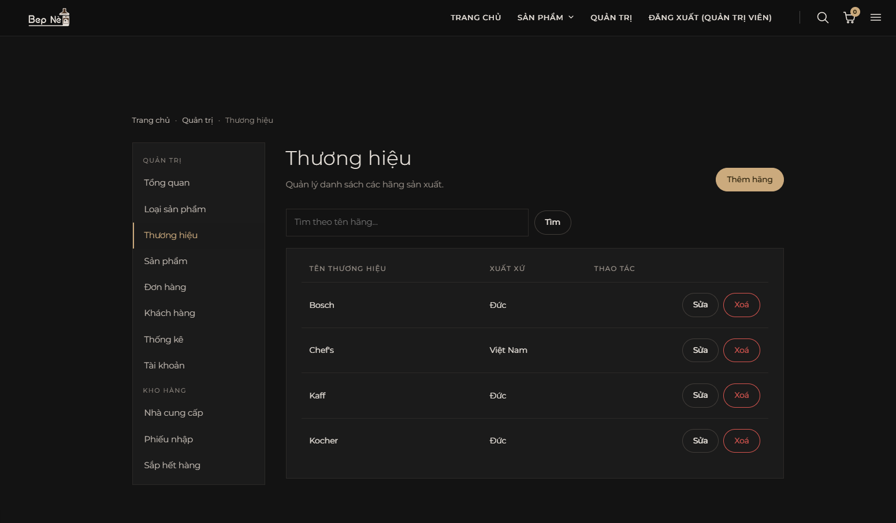

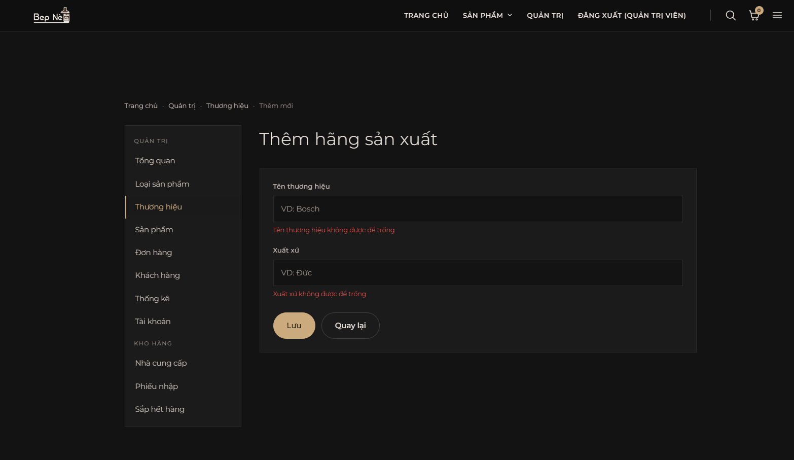

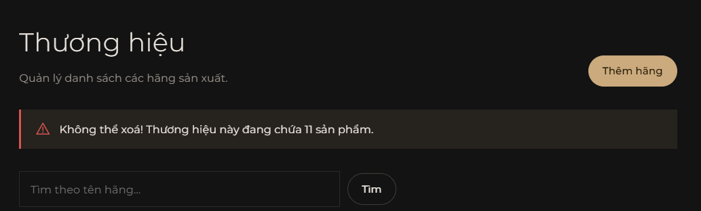

### 5.2. Nhập kho và cảnh báo tồn kho

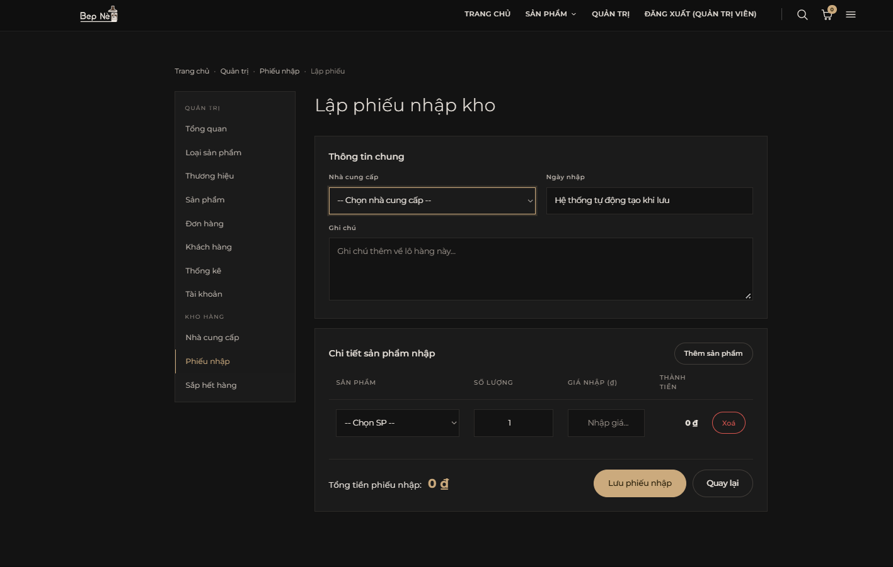

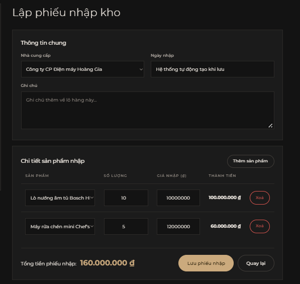

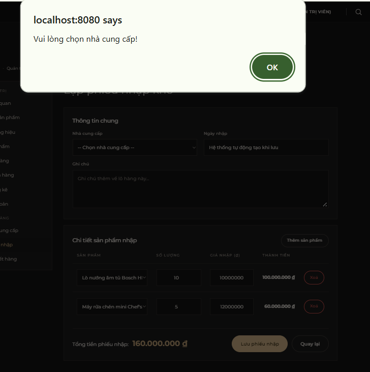

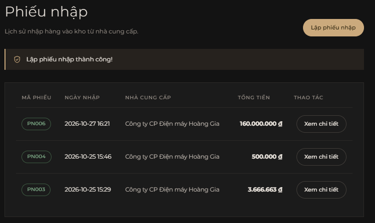

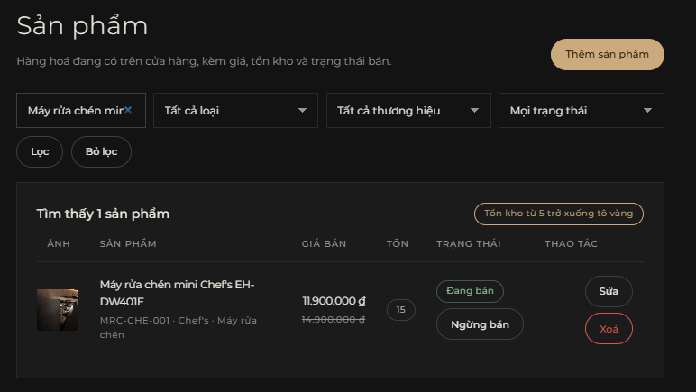

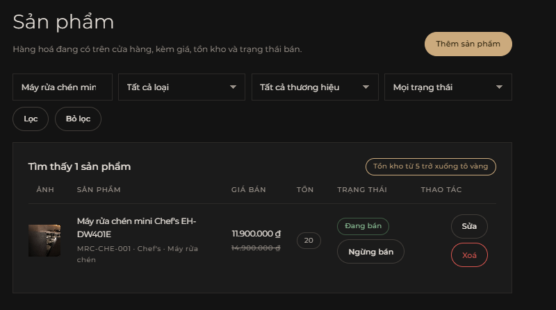

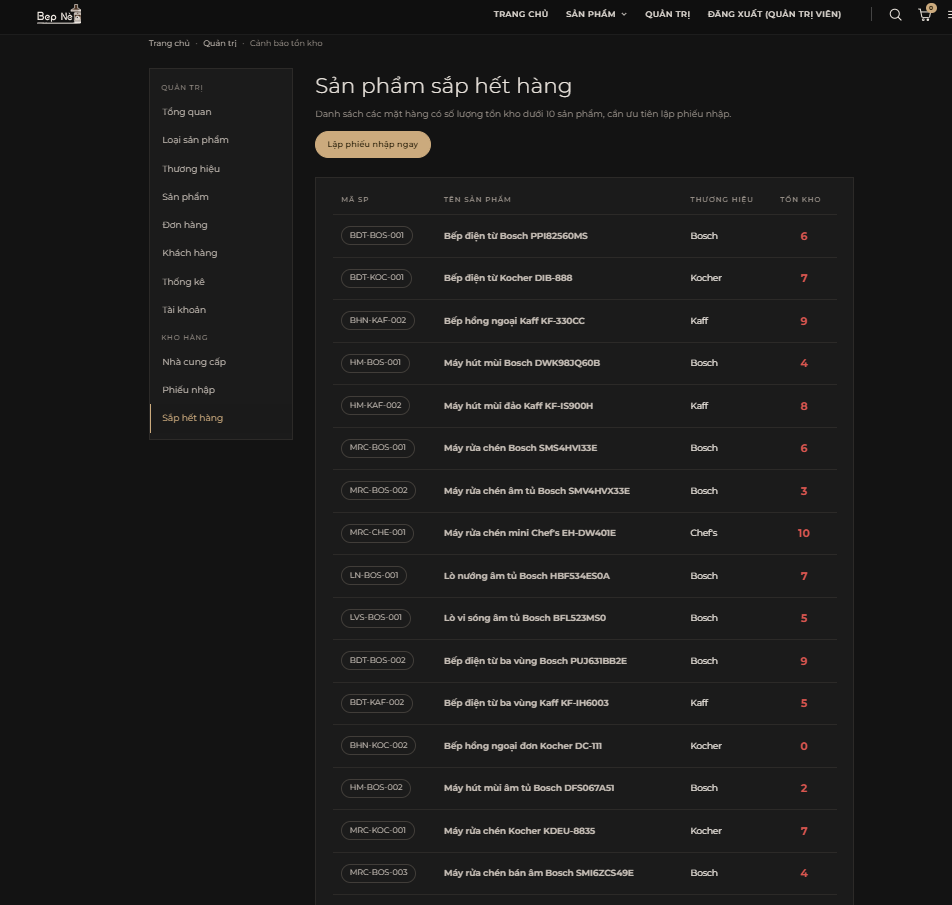

## 6. Dữ liệu mẫu

Dữ liệu mẫu nằm chung trong `src/main/resources/data.sql` của nhóm, chạy mỗi lần khởi động
(`spring.sql.init.mode=always`), dùng `INSERT IGNORE` theo khoá chính nên chạy lại nhiều lần không bị trùng.

| Bảng | Số dòng | Ghi chú |
|---|---|---|
| `thuong_hieu` | 4 | Bosch, Kaff, Kocher (Đức), Chef's (Việt Nam) |
| `nha_cung_cap` | 3 | Dùng cho phiếu nhập |
| `phieu_nhap` | [điền] | Phiếu mẫu để thử danh sách và chặn xoá nhà cung cấp |
| `chi_tiet_phieu_nhap` | [điền] | Dòng chi tiết của các phiếu mẫu |

Các trường hợp đặc biệt cố ý đưa vào để thử chức năng của module:

- Sản phẩm **hết hàng**: `BHN-KOC-002` (tồn 0), dùng thử cảnh báo kho và nhập bổ sung.
- Sản phẩm **sắp hết hàng** (tồn từ 1 tới 5): 8 sản phẩm, ví dụ `HM-BOS-002` còn 2, hiện trong màn hình cảnh báo.
- Nhà cung cấp **đã có phiếu nhập**: dùng thử chặn xoá và cảnh báo đỏ.
- Nhà cung cấp **chưa có phiếu nhập**: dùng thử xoá thành công.
- Thương hiệu **đang có sản phẩm**: dùng thử chặn xoá thương hiệu.

## 7. Giao diện phía quản trị

Giao diện dùng chung hệ thống của nhóm (`site.css`, `ung-dung.css`, các fragment trong `layout/fragments.html`),
không thêm thư viện nào.

Các trang phía quản trị do TV2 làm:

| Trang | Thành phần chính |
|---|---|
| Nhà cung cấp | Danh sách, ô tìm theo từ khoá, nút Thêm, Sửa, Xoá, cảnh báo đỏ khi bị chặn xoá |
| Biểu mẫu nhà cung cấp, thương hiệu | Các ô nhập, lỗi `@Valid` hiện dưới từng ô |
| Thương hiệu | Danh sách, biểu mẫu thêm và sửa, cảnh báo khi bị chặn xoá |
| Lập phiếu nhập | Chọn nhà cung cấp, bảng chi tiết sản phẩm thêm hoặc xoá dòng, thành tiền và tổng tiền tự tính, nút Lưu phiếu nhập |
| Cảnh báo sắp hết hàng | Danh sách sản phẩm có tồn kho <= 10 |

Thông báo lỗi nghiệp vụ hiển thị màu đỏ, nói rõ lý do bị từ chối.

## 8. Kiểm thử phần TV2

Các ca kiểm thử dưới đây chạy trên ứng dụng thật với cơ sở dữ liệu mới tạo. Cột Kết quả điền sau khi chạy.

| Mã | Ca kiểm thử | Kết quả mong đợi | Kết quả |
|---|---|---|---|
| TC-NCC-01 | Mở trang Nhà cung cấp | Hiện đủ danh sách nhà cung cấp | [điền] |
| TC-NCC-02 | Tìm nhà cung cấp theo từ khoá có và không có kết quả | Lọc đúng; không có kết quả thì hiện danh sách rỗng hoặc thông báo | [điền] |
| TC-NCC-03 | Lưu biểu mẫu nhà cung cấp để trống tên | Không lưu, báo lỗi dưới ô tên | [điền] |
| TC-NCC-04 | Thêm nhà cung cấp đủ thông tin | Lưu thành công, hiện trong danh sách | [điền] |
| TC-NCC-05 | Sửa thông tin nhà cung cấp | Dữ liệu được cập nhật | [điền] |
| TC-NCC-06 | Xoá nhà cung cấp chưa có phiếu nhập | Xoá thành công | [điền] |
| TC-NCC-07 | Xoá nhà cung cấp đã có phiếu nhập | Báo lỗi đỏ, không xoá | [điền] |
| TC-TH-01 | Xoá thương hiệu đang có sản phẩm | Báo lỗi, không xoá | [điền] |
| TC-TH-02 | Xoá thương hiệu chưa có sản phẩm | Xoá thành công | [điền] |
| TC-PN-01 | Mở form lập phiếu nhập | Có nhà cung cấp để chọn, bảng chi tiết trống | [điền] |
| TC-PN-02 | Thêm 2 dòng sản phẩm, số lượng 3 giá 100000 và số lượng 2 giá 50000 | Thành tiền 300000 và 100000, tổng tiền 400000 | [điền] |
| TC-PN-03 | Xoá một dòng chi tiết | Tổng tiền tính lại ngay | [điền] |
| TC-PN-04 | Bấm Lưu khi chưa chọn nhà cung cấp | JavaScript chặn gửi, báo lỗi | [điền] |
| TC-PN-05 | Nhập số lượng hoặc giá bằng 0 hoặc số âm | JavaScript chặn gửi, báo lỗi | [điền] |
| TC-PN-06 | Lưu phiếu nhập hợp lệ | Lưu `PhieuNhap` và `ChiTietPhieuNhap`, báo thành công | [điền] |
| TC-PN-07 | So sánh `soLuongTon` trước và sau khi lưu phiếu | Tồn kho tăng đúng bằng số lượng nhập | [điền] |
| TC-PN-08 | Gây lỗi khi cập nhật tồn kho | Rollback, không có phiếu nhập nào được lưu, tồn kho giữ nguyên | [điền] |
| TC-CB-01 | Mở màn hình cảnh báo | Chỉ hiện sản phẩm có tồn <= 10 | [điền] |
| TC-CB-02 | Nhập thêm cho sản phẩm đang sắp hết hàng để tồn vượt 10 | Sản phẩm biến khỏi danh sách cảnh báo | [điền] |
| TC-PQ-01 | Tài khoản khách mở hoặc gửi POST tới các đường dẫn quản trị của module | Bị chặn theo phân quyền của TV1 | [điền] |

## 9. Mức độ hoàn thành

| Chức năng | Mức độ | Ghi chú |
|---|---|---|
| Xem, tìm kiếm, thêm, sửa Nhà cung cấp và Thương hiệu | Hoàn thành | Có xác thực `@Valid` |
| Ràng buộc xoá Thương hiệu và Nhà cung cấp | Hoàn thành | Ném `LoiNghiepVu`, cảnh báo đỏ trên giao diện |
| Lập phiếu nhập bằng form động | Hoàn thành | Thêm hoặc xoá dòng, tự tính tiền bằng JavaScript |
| Lưu phiếu nhập trong transaction và cộng tồn kho | Hoàn thành | Rollback toàn bộ khi lỗi |
| Cảnh báo sắp hết hàng | Hoàn thành | Ngưỡng tồn <= 10 |
| Bộ lọc phiếu nhập theo khoảng thời gian | Chưa làm | Dự kiến tuần 11 |
| Sơ đồ use case, đặc tả use case | Hoàn thành | `use-case-tv2.png`, `dac-ta-use-case-tv2.md` |
| Mô tả chức năng, từ điển dữ liệu | Hoàn thành | `docs/chuc-nang.md`, `tu-dien-du-lieu-tv2.docx` |

Việc theo tiến độ tuần của nhóm:

| Tuần | Việc | Trạng thái |
|---|---|---|
| 5 | Liệt kê chức năng của module vào `docs/chuc-nang.md` | Xong |
| 6 | Vẽ mockup màn hình, viết Entity và Repository | Xong |
| 7 | Hoàn thiện lập trình chức năng, tạo Pull Request vào main | Xong |
| 7 | Kiểm thử chéo module Sản phẩm (TV3) | Đã hoàn thành nghiệm thu |
| 8 | Chụp màn hình và viết phần báo cáo cá nhân | Xong (tài liệu này) |

## 10. Kế hoạch tuần 9 tới 14

| Tuần | Việc dự kiến |
|---|---|
| 9 | Hỗ trợ TV3 sửa các bug giao diện (nếu có) phát hiện qua kiểm thử chéo |
| 10 | Rà soát lại luồng kiểm tra tồn kho khi TV4 (Đặt hàng) tiến hành merge code |
| 11 | Bổ sung thêm bộ lọc theo khoảng thời gian (Từ ngày - Đến ngày) cho Danh sách Phiếu nhập |
| 12-13 | Phối hợp rà soát toàn bộ giao diện theo `QUY_TAC_GIAO_DIEN.md` |
| 14 | Hoàn thiện báo cáo tổng kết, tập demo luồng Nhập hàng -> Trưng bày -> Bán hàng |

---

## PHỤ LỤC: ĐẶC TẢ USE CASE

**UC-TV2-01. Quản lý Nhà cung cấp**

- **Mô tả:** Cho phép quản trị viên xem, thêm, sửa, xóa thông tin nhà cung cấp và tìm kiếm nhà cung cấp.
- **Điều kiện trước:** Đăng nhập với quyền ADMIN.
- **Luồng chính:**
  1. Truy cập chức năng Nhà cung cấp.
  2. Điền biểu mẫu thêm/sửa, hệ thống kiểm tra bỏ trống (`@Valid`).
  3. Lưu và hiển thị danh sách.
- **Luồng ngoại lệ (Xóa):** Khi bấm Xóa, nếu nhà cung cấp đã có phiếu nhập, hệ thống từ chối xóa và ném `LoiNghiepVu`, hiển thị cảnh báo đỏ bảo vệ dữ liệu.

**UC-TV2-02. Lập phiếu nhập kho & Cộng tồn kho**

- **Mô tả:** Lập phiếu nhập, tạo bảng chi tiết động, tính tiền và cập nhật tồn kho sản phẩm.
- **Điều kiện trước:** Có sẵn dữ liệu Sản phẩm và Nhà cung cấp.
- **Luồng chính:**
  1. Mở Form Lập phiếu nhập.
  2. Chọn nhà cung cấp, thêm các dòng sản phẩm, điền số lượng và giá.
  3. Nhấn Lưu, JavaScript kiểm tra dữ liệu không trống, số lượng/giá > 0.
  4. Backend nhận dữ liệu, lưu vào `PhieuNhap` và `ChiTietPhieuNhap`.
  5. Cộng dồn số lượng vào cột `soLuongTon` của từng `SanPham`.
